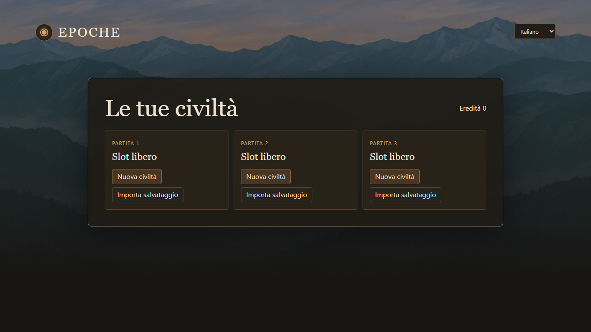
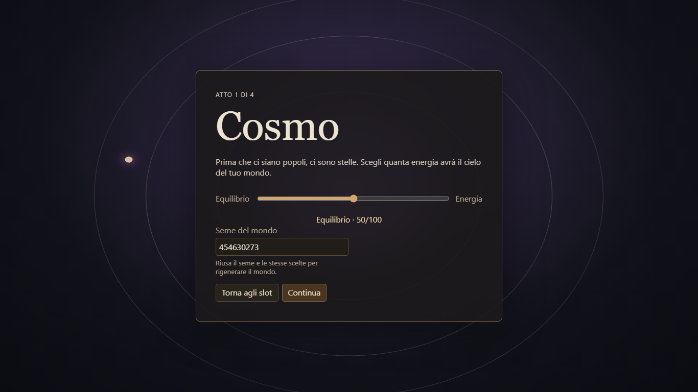
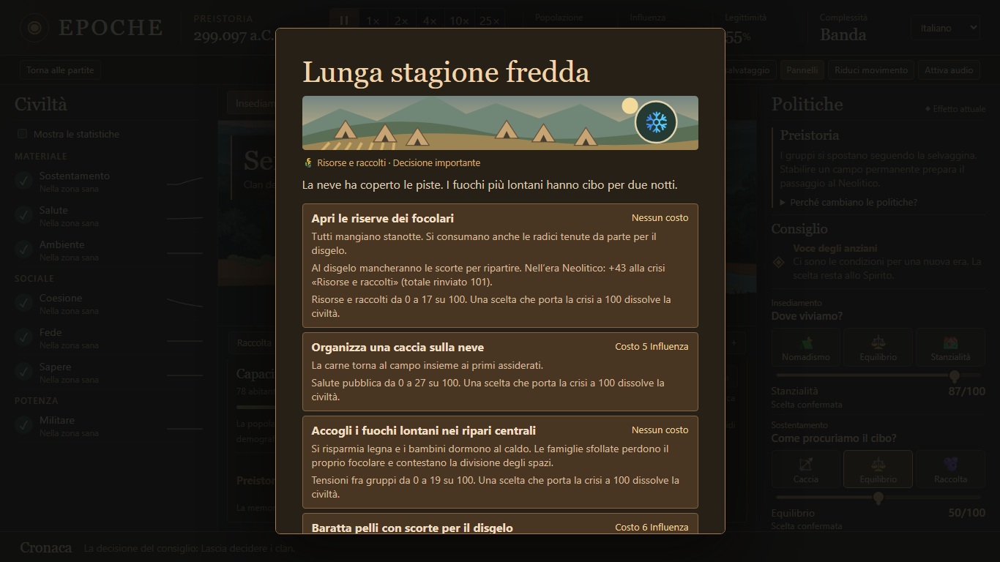
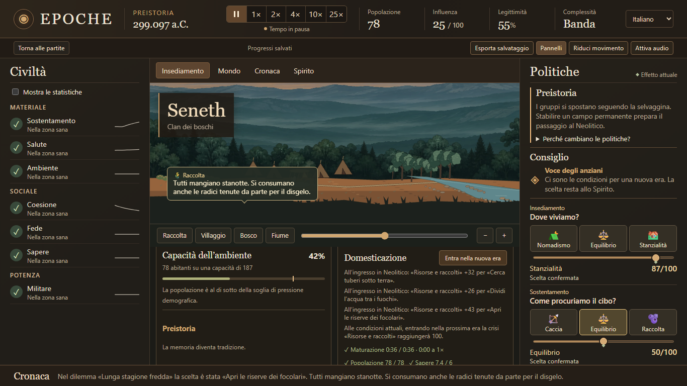
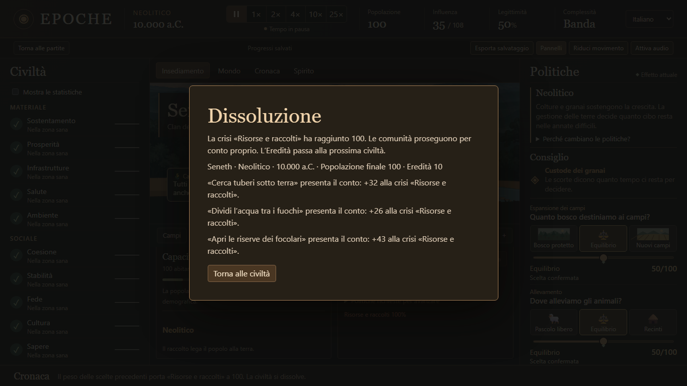
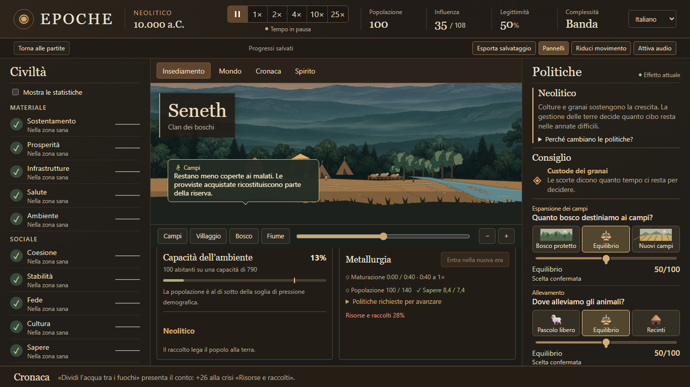
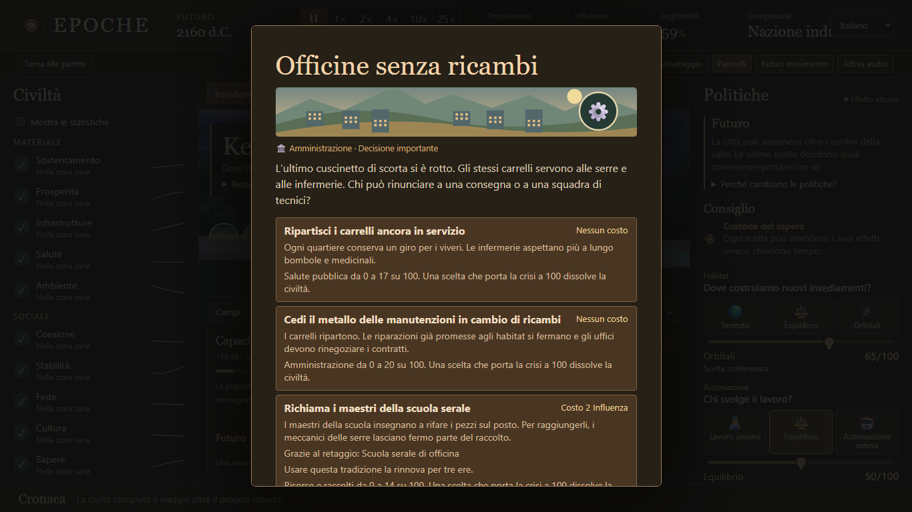
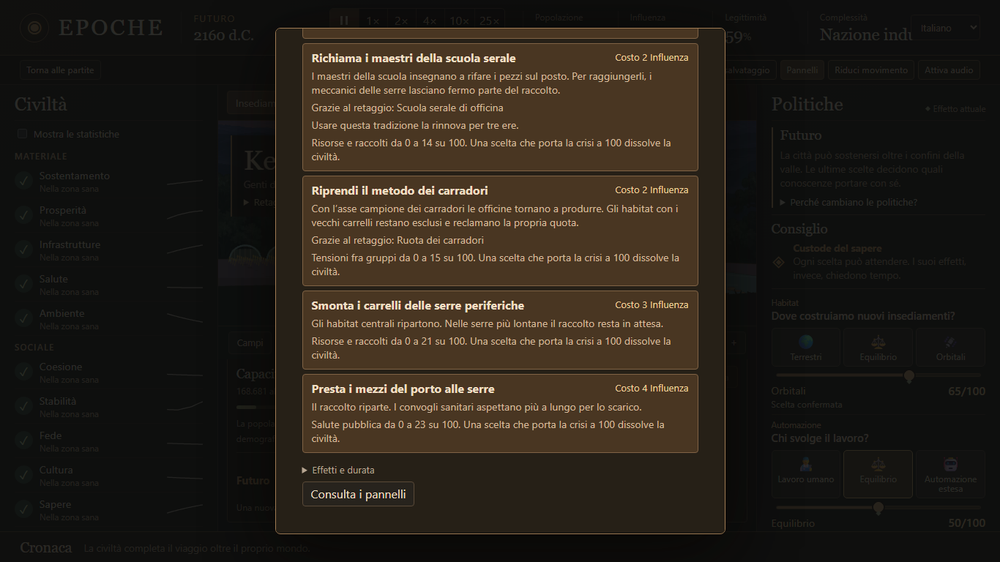
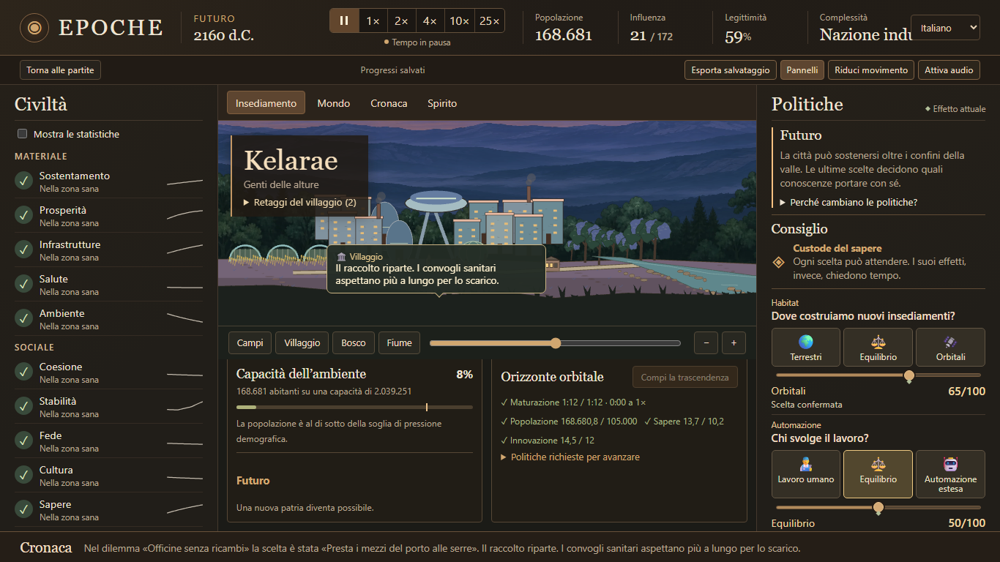
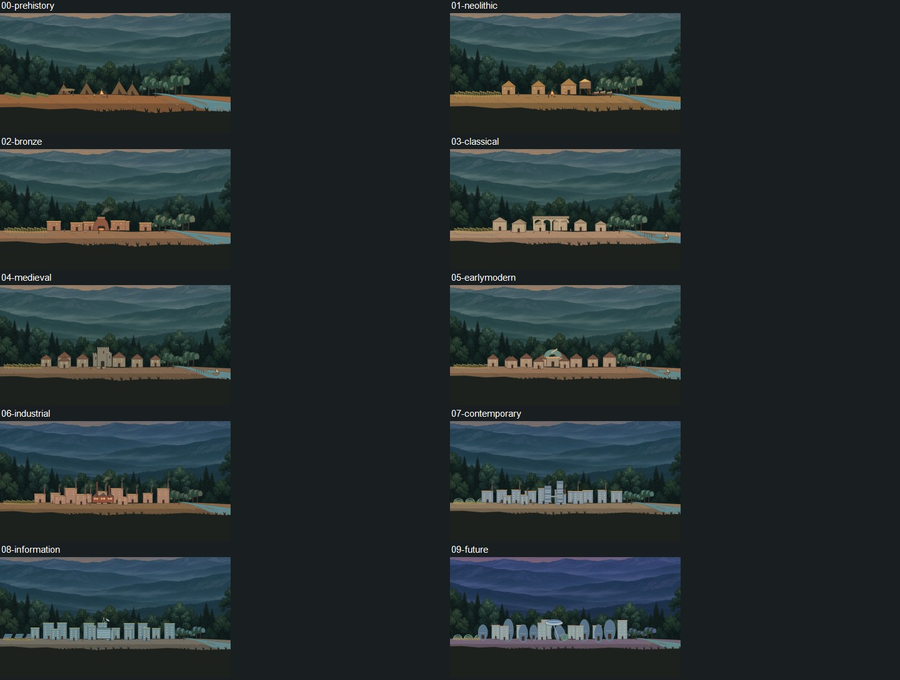

# EPOCHE in dieci schermate

Le prime nove immagini sono catture del gioco locale in Chrome a 1366 × 768. Le immagini da 3 a 6 mostrano due rami dello stesso salvataggio di prova. In entrambi il villaggio ha già rinviato 58 punti di crisi alimentare. Nelle immagini da 7 a 9 il salvataggio del Futuro conserva la ruota e la scuola serale. L’ultima tavola riunisce le dieci ere fotografate nella precedente verifica del diorama.

## Scelta dello slot

## Genesi

## Il lungo inverno

## Il villaggio prima del cambio di era

## Dissoluzione dopo l’apertura delle riserve

## Neolitico dopo il baratto delle pelli

## Officina degli habitat con due retaggi

## Risposte in fondo all’officina

## Il villaggio nel Futuro dopo la scelta

## Le dieci ere, dalla verifica precedente

