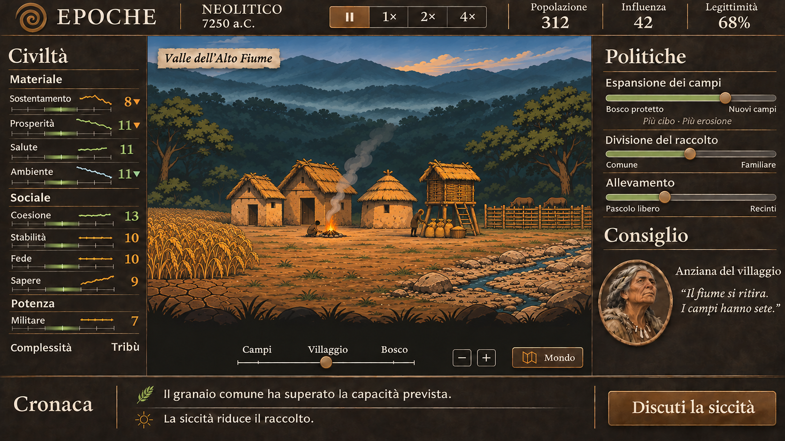

# Riferimenti visivi di Epoche

| Elemento | Riferimento | Scelta |
|---|---|---|
| Inquadratura iniziale | [Mockup neolitico v3](reference/mockup-neolitico-v3.png) | Profilo, campi e case nello stesso quadro, cielo ridotto |
| Zoom ravvicinato | [Mockup neolitico v2](reference/mockup-neolitico-v2.png) | Le case possono essere ingrandite senza perdere la vista delle zone vicine |
| Sfondo lontano | [Montagne e cielo](../public/art/valley-distance.webp) | Creste fredde e nebbia. Si spostano poco con la telecamera |
| Piano intermedio | [Fascia di bosco](../public/art/valley-woods.webp) | Masse scure con bordi irregolari. La fascia si sposta più delle montagne |
| Primo piano | [Guida artistica](ART_DIRECTION.md) | Terra in ombra, figure piccole e luci di fuoco che orientano lo sguardo |
| Interfaccia | [Mockup neolitico v3](reference/mockup-neolitico-v3.png) | Argilla scura, bordi bronzo, accenti cromatici accompagnati da simboli |

I due sfondi raster sono stati creati con ImageGen per la versione locale. Campi, edifici, figure, acqua e altri elementi in gioco sono moduli PixiJS. Usano forme diverse per le dieci ere e cambiano con popolazione, salute, scorte, siccità e guerra. Per la versione commerciale resta il kit di illustrazioni definitivo previsto dalla guida.
